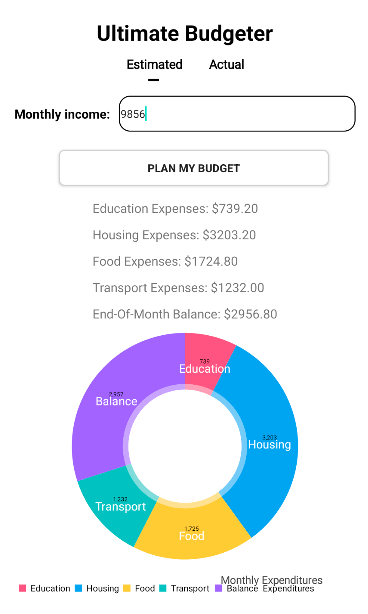
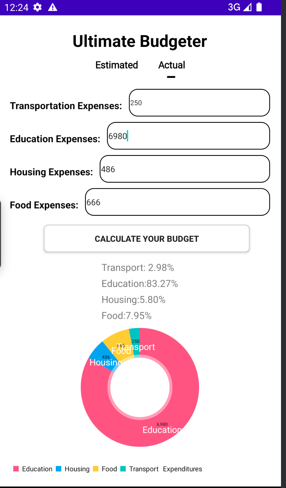

# Ultimate Budgeter — Design Specification

## 1. Design objective and authority

Reproduce a compact native portrait Android screen with a white/light surface, strong black heading and labels, rounded outlined input fields, white outlined action buttons, gray textual results, and colorful doughnut charts. There are exactly two pages: Estimated and Actual.

Read [Product](01_PRODUCT_REQUIREMENTS.md), [Technical](03_TECHNICAL_SPECIFICATION.md), and [Testing](04_TEST_SPECIFICATION.md). Explicit XML dimensions and explicit Java chart settings below take precedence over screenshots. Library and operating-system defaults fill unspecified details. The included screenshots are existing reference images; no new runtime capture was performed for this specification.

## 2. Visual references and discrepancies

| Reference | Meaning |
|---|---|
| [Estimated result](../../doc/estimated.png) | Income 9856, five money lines, five-slice doughnut |
| [Actual result](../../doc/actual1.png) | Inputs 250 / 6980 / 486 / 666, percentage list, four-slice doughnut |
| [Estimated empty](../../doc/estimated_error.png) | Empty income with results hidden |
| [Actual incomplete](../../doc/actual_error.png) | Empty housing with results hidden |
| [Existing demo video](../../doc/uni_dramer.mov) | Supplemental original artifact; not analyzed for this specification |





The screenshots show a white content area, no separate visible app-title action bar, and sometimes a purple Android status bar. The source theme is `Theme.MaterialComponents.DayNight.DarkActionBar`, but the host is `FragmentActivity`, not AppCompatActivity; it does not explicitly request or hide an action bar. Do not infer a new toolbar from the theme name. Verify actual window decoration when rebuilding.

Screenshot chart hues differ visibly from the exact Java RGB palette. Use the source palette in section 6 for the default reconstruction. Button shadows, uppercase transformation, cursor color, result text size/color, legend layout, and chart geometry partly derive from defaults; compare on a fixed device and library version. Do not copy screenshot pixel coordinates as dp values or reproduce status-bar times, cellular icons, or capture artifacts as app content.

## 3. Screen hierarchy

```text
Portrait activity
└── Vertical home container (match-parent width, wrap-content height)
    ├── Ultimate Budgeter heading, centered
    ├── Estimated | Actual tab strip, centered
    └── ViewPager, full width, wrap-content height
        ├── Estimated vertical page, 16dp padding
        │   ├── Label + monthly income input row
        │   ├── Plan My Budget button
        │   └── Results container
        │       ├── Five stacked money lines
        │       └── PieChart, 300dp height
        └── Actual vertical page, 16dp padding
            ├── Transportation input row
            ├── Education input row
            ├── Housing input row
            ├── Food input row
            ├── Calculate Your Budget button
            └── Results container
                ├── Four stacked percentage lines
                └── PieChart, 300dp height
```

There is no ScrollView, bottom navigation, floating action button, modal, error banner, or separate result page. Hidden results occupy no layout space. Both result lists are a vertical sequence inside RelativeLayout containers with horizontal centering of the group and left-aligned line text.

## 4. Shared layout and components

| Component | Explicit source specification |
|---|---|
| Heading | `Ultimate Budgeter`; black; 24sp; bold; centered; 20dp top margin |
| Tab strip | Wrap-content width; centered; 38dp height; 14sp titles |
| Tab titles | `Estimated`, then `Actual`; black for selected and unselected; host applies fake bold to both |
| Selected indicator | Black; 12dp width; 3dp height |
| Tab spacing | 15dp tab padding; equal spacing disabled |
| Underline | Black configured color; bottom gravity; thickness not explicitly set |
| Page root | Vertical LinearLayout; match-parent width and height; 16dp padding |
| Form label | Black; bold; 14sp; wrap-content; left of its input and vertically centered |
| Input | Remaining row width; 40dp height; 10dp start margin after label; 2dp horizontal padding |
| Input outline | Transparent fill; black 1dp stroke; 12dp corner radius |
| Input states | Focused, selected, and default use the same outline |
| Input keyboard | `number`, no explicit decimal or signed flags |
| Input hint color | `@color/cardview_shadow_start_color`, a dependency-provided color, not a project-defined token |
| Button | 300dp × 40dp; centered horizontally; 10dp start margin; 1dp padding; bold 12sp text |
| Button background | White; 1dp `#D1D1D1` outline; 6dp corner radius |
| Result text | Native TextView defaults unless explicitly noted; screenshots show gray body text |
| Chart view | Match-parent width; 300dp height; below result list |

The source button text is title case; the native/theme button default may render it uppercase as in screenshots. Preserve equivalent default rendering rather than changing the required source labels. No custom font assets exist; use platform fonts.

## 5. Page-specific details and exact copy

### Estimated

One input row with no explicit bottom padding:

| Property | Value |
|---|---|
| Label | `Monthly income:` |
| Hint | `please input your monthly income` |
| Input text size | 12sp |
| Action source text | `Plan My Budget` |
| Button top margin | 20dp |
| Results container top margin | 10dp |
| Result line vertical margin | 5dp per line |

Display Education, Housing, Food, Transport, End-Of-Month Balance in that order using the exact money templates in Product section 5.

### Actual

Four rows, each with 8dp bottom padding:

| Row | Label | Hint | Input text size |
|---|---|---|---:|
| 1 | `Transportation Expenses:` | `please input your transportation expenses` | 10sp |
| 2 | `Education Expenses:` | `please input your education expenses` | 12sp |
| 3 | `Housing Expenses:` | `please input your housing expenses` | 12sp |
| 4 | `Food Expenses:` | `please input your food expenses` | 12sp |

Labels are individually wrap-content, so input left edges are intentionally staggered rather than aligned to a single column. Button source text is `Calculate Your Budget`, with 5dp top and bottom margins. The results container has 5dp top margin; each result line has 2dp vertical margin. Result order is Transport, Education, Housing, Food. Do not substitute `Transportation` for `Transport` in outputs or charts.

### Error feedback

Use short Android Toasts with the exact case and punctuation in Product section 7. No inline error message, red border, field-clearing action, or forced focus change exists. Blank-state screenshots do not show the Toast and should not be interpreted as a different feedback requirement.

## 6. Chart specification

Use MPAndroidChart's PieChart with native defaults for the doughnut hole, transparent ring, slice values, entry labels, legend, rotation, and value formatter. The source does not set percent-value mode, hole radius, center text, legend positioning, slice spacing, or a custom value formatter. Preserve defaults by using the pinned library rather than inventing a second chart style. Screenshots show white category labels, black rounded numeric values, a white center, and a lighter inner ring; numeric slice labels are raw amounts, not the two-decimal monetary output strings.

| Slice order | Category | Exact RGB | Hex | Present on |
|---:|---|---|---|---|
| 1 | Education | 255, 99, 132 | #FF6384 | Both |
| 2 | Housing | 54, 162, 235 | #36A2EB | Both |
| 3 | Food | 255, 206, 86 | #FFCE56 | Both |
| 4 | Transport | 75, 192, 192 | #4BC0C0 | Both |
| 5 | Balance | 153, 102, 255 | #9966FF | Estimated only |

Both datasets are named `Expenditures`. Provide all five colors to both datasets; Actual uses only the first four. The legend is enabled by default and includes category names with colored markers; dataset naming can affect the trailing legend description.

Explicit settings:

- Description enabled with text `Monthly Expenditures`.
- Description text size 12f and color `Color.DKGRAY` (`#444444`).
- Description position `(900, 750)` in chart pixel coordinates, not dp. Preserve this source setting in fidelity mode even if offscreen or overlapping on some devices.
- Tap highlighting enabled.
- Each successful calculation sets a new PieData and calls `animateY(1400)`.
- No center label or tooltip is implemented by app code.

Do not hide small slices, merge categories, or change the palette to fix label overlap. The uneven Actual screenshot demonstrates overlapping labels in small slices; record such limitations during visual QA.

## 7. Theme and assets

Day theme primary `#6200EE`, primary variant `#3700B3`, on-primary white, secondary `#03DAC5`, secondary variant `#018786`, on-secondary black. Night theme primary `#BB86FC`, primary variant `#3700B3`, on-primary black, secondary and variant `#03DAC5`, on-secondary black. The status bar uses the primary variant. Static black form text and white button backgrounds remain explicit in both themes, so dark-mode contrast is a known issue.

Additional defined but unused screen tokens: brand `#D8AE15`, fill_card1 `#F2F2F2`. Do not introduce gold accents into these pages merely because the token exists.

Launcher artwork is the stock Android template: green `#3DDC84` gridded background and white Android robot foreground with diagonal shadow. Preserve existing vector and WebP mipmap assets if available. For an empty-repository recreation, recreate the stock template icon; exact byte identity of generated artwork is not a functional acceptance requirement. Both normal and round adaptive icons use the same foreground/background and monochrome foreground.

## 8. Device behavior and quality limits

Portrait is locked in the manifest. RelativeLayout rows use legacy left/right positioning even though the application declares RTL support. There are no responsive breakpoints, insets handlers, tablet layouts, landscape layouts, or explicit keyboard hide calls. Large font sizes or short devices may clip content because fixed heights and no scrolling are used.

The design acceptance baseline is an English, light-mode portrait device with a recorded screen size, density, API, and font scale. Dark mode, RTL, keyboard visibility, and small screens are characterization checks. Optional work such as adding scrolling, improving accessibility targets, fixing contrast, or anchoring the chart description requires a separately selected improvement mode; it is not part of default fidelity requirements.
